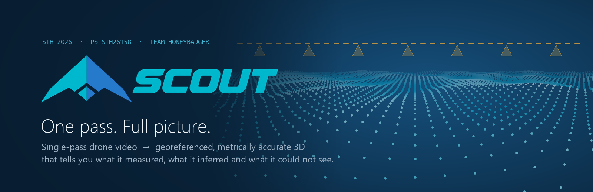
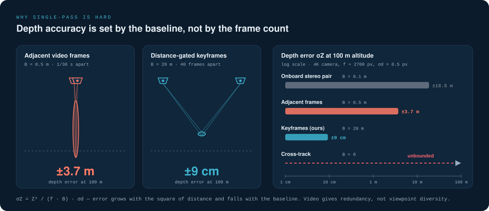
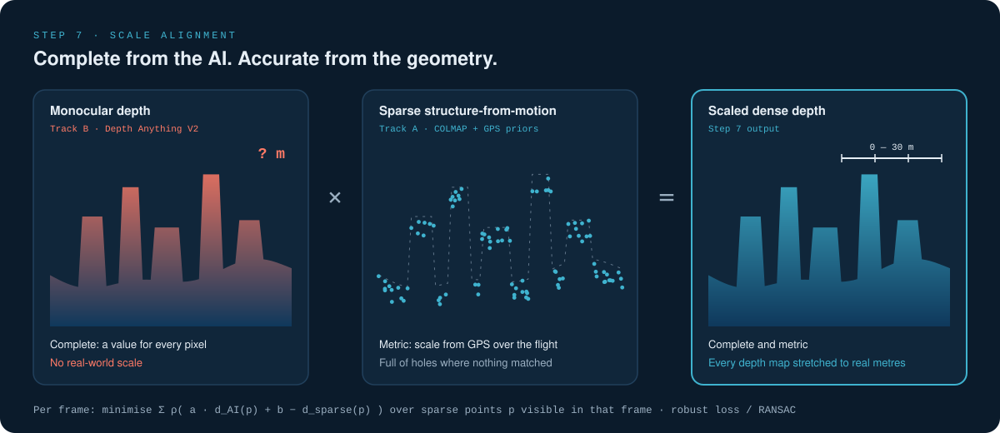
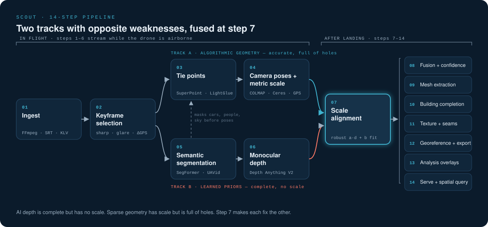
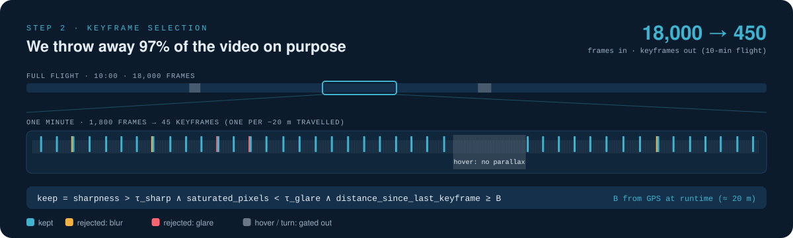
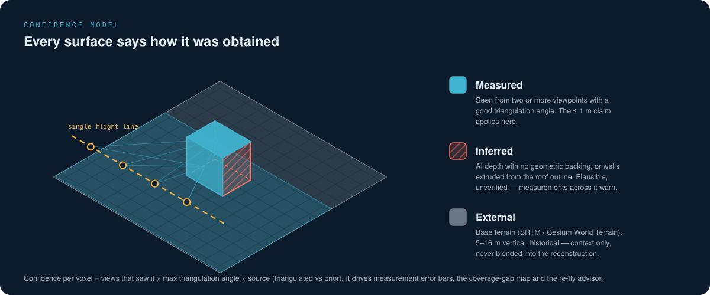
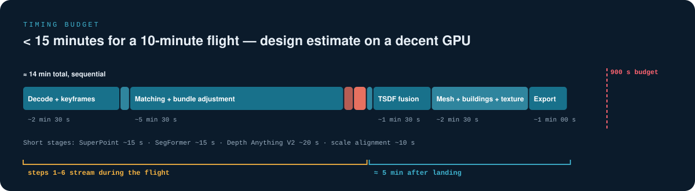

  

  <b>Single-pass drone video → georeferenced, metrically accurate, textured 3D model.</b> 
  And it tells you what it measured, what it inferred, and what it could not see.

  
  
  
  
  

  <a href="#the-problem">Problem</a> ·
  <a href="#why-single-pass-is-hard">Why it's hard</a> ·
  <a href="#the-idea">The idea</a> ·
  <a href="#the-pipeline">Pipeline</a> ·
  <a href="#confidence-model">Confidence</a> ·
  <a href="#outputs">Outputs</a> ·
  <a href="#timing-budget">Timing</a> ·
  <a href="#decision-support">Decision support</a> ·
  <a href="#technology-stack">Stack</a> ·
  <a href="#validation-plan">Validation</a> ·
  <a href="#roadmap">Roadmap</a>

---

> [!NOTE]
> Scout is being built by **Team Honeybadger** for Smart India Hackathon 2026, problem statement **SIH26158** (National Technical Research Organisation). This README describes the system design. Figures such as ±9 cm or "< 15 minutes" are **design targets and worked calculations**, not measured results — measured numbers will be published from the benchmark harness as the pipeline comes online.

## The problem

In disaster response, surveillance, infrastructure inspection and rapid mapping there is often **one chance** to fly over a site. Conventional photogrammetry needs grid flights, heavy image overlap, surveyed ground control points and hours of processing. Scout's goal is a georeferenced, metrically accurate, textured 3D model from **one single-pass drone video** — no grid, no second pass, no surveyed markers — in near real time.

| Target (from the problem statement) | Value |
|---|---|
| Reconstruction type | 3D mesh / point cloud |
| Processing time | **< 15 minutes for a 10-minute video** |
| Spatial accuracy | **≤ 1 m** |
| Coverage | Entire visible scene |
| Output formats | OBJ · PLY · LAS · GeoTIFF · GLB/GLTF · FBX |
| Visualisation | Web-based viewer with measurement |

Mandatory inputs are the video, GPS and flight metadata. IMU, barometric altitude, camera intrinsics and RTK/PPK are optional — Scout runs without them and gets better with each one ([capability tiers](#optional-inputs-and-capability-tiers)).

## Why single-pass is hard

3D reconstruction is triangulation, and triangulation needs viewpoints that are far apart relative to the distance of the scene. Depth uncertainty is

$$\sigma_Z = \frac{Z^2}{f\,B}\,\sigma_d$$

where $Z$ is distance to the surface, $f$ the focal length in pixels, $B$ the baseline between the two views and $\sigma_d$ the matching error. Error grows with the **square** of distance and falls with the **baseline**.

At 100 m altitude with a 4K camera (f ≈ 2700 px) and σd = 0.5 px:

| Frame pair | Baseline | Depth error |
|---|---|---|
| Adjacent video frames (1/30 s apart) | 0.5 m | **±3.7 m** |
| 40 frames apart (1.3 s) | 20 m | **±9 cm** |
| Onboard stereo camera | 0.1 m | ±18.5 m |
| Cross-track (any pair) | ≈ 0 m | unbounded |

Three things fall out of this:

- **Video gives redundancy, not viewpoint diversity.** Feeding every frame to a photogrammetry engine produces thousands of images and poor geometry.
- **Along-track baseline is free.** At 100 m the ground footprint is ~140 m, so a 20 m baseline still leaves ~86 % overlap.
- **Cross-track baseline is zero.** One flight line constrains geometry along the track and not across it. A single oblique pass sees roughly two of a building's five exterior surfaces. There is no camera angle that satisfies the brief from one pass — so Scout supplies learned priors for the unseen faces and labels them honestly.

Other named failure modes the design handles: bas-relief ambiguity (focal length trades against depth on thin baselines — intrinsics are held fixed), near-degenerate straight-line motion over flat ground (homography vs essential-matrix model selection), no loop closure (GPS enters bundle adjustment as a soft prior), rolling shutter, motion blur (a 4× accuracy penalty at 2 px matching error), glare, H.264 block artifacts, moving objects, vegetation, texture-poor surfaces, and the ellipsoid-vs-geoid height trap (tens of metres over India).

## The idea

**Monocular depth models and structure-from-motion have exactly opposite failure modes.**

| | Monocular depth (AI) | Sparse SfM (geometry) |
|---|---|---|
| Coverage | Dense — every pixel | Sparse — only where features matched |
| Scale | No reliable absolute scale | Metric, anchored by GPS |
| Thin baseline | Unaffected — it doesn't triangulate | Degrades badly |
| Texture-poor surfaces | Fine — infers from context | Fails — nothing to match |
| Speed | ~30 ms per frame | Dense MVS ~30 s per frame |
| Risk | Plausible-but-wrong geometry | Holes, but honest holes |

So Scout fits the monocular depth maps to the sparse metric points to recover scale, then uses the scaled depth to fill everything geometry could not reach.

This one step serves three scoring criteria at once: **accuracy** (scale comes from GPS-anchored geometry, not from the AI), **completeness** (the prior covers weakly observed and texture-poor surfaces) and **speed** (monocular depth is ~1000× faster than classical multi-view stereo — the only dense method that fits the time budget).

## The pipeline

Two tracks run in parallel and converge at step 7. Steps 1–6 stream while the drone is still in the air; steps 7–14 complete after landing.

<b>Track A — algorithmic geometry (steps 1–4)</b>

**1 · Ingest.** Pair every frame with where the drone was. Parsers for DJI SRT subtitle logs, generic CSV flight logs, EXIF/embedded metadata via FFmpeg, and **MISB KLV / STANAG 4609** for defence platforms, plus a manual fallback (altitude, start/end coordinates, heading). Resolution and frame rate are auto-detected, never hard-coded.

**2 · Keyframe selection.** Score every frame for sharpness (Laplacian variance), glare (saturated-pixel ratio) and exposure, and keep one only when it passes **and** the drone has travelled a GPS-measured baseline `B` since the last keyframe. `B` is computed at runtime from altitude and speed (≈ 20 m at 100 m / 15 m s⁻¹). Because the gate is on *distance*, hover, pause and turn segments produce no keyframes at all. See [keyframe selection](#keyframe-selection).

**3 · Tie points.** SuperPoint detection and LightGlue matching — learned features hold up under blur and H.264 blocking where SIFT degrades. Video order is known, so each frame is matched only against its neighbours plus GPS-nearby candidates: ~2,250 pairs instead of ~101,000. These are **tie points** found in the imagery, not ground control points.

**4 · Camera poses + metric scale.** Incremental structure-from-motion in COLMAP with Ceres bundle adjustment. GPS enters as a **soft prior** weighted by its covariance; gimbal metadata is the initial orientation guess, IMU gravity anchors roll and pitch, and bundle adjustment refines everything together. Output: camera poses plus a sparse cloud (~200k points for a 10-minute flight) in real-world metres.

<b>Track B — learned priors (steps 5–6)</b>

**5 · Semantic segmentation.** SegFormer fine-tuned on **UAVid** (oblique drone footage — Cityscapes' street-level viewpoint transfers badly) labels building, road, vegetation, ground, vehicle, person and sky. One model, three jobs: mask moving objects *before* pose estimation, exclude sky, and keep the labels for the semantic model. SAM was rejected — it outlines regions without naming them and costs ~1 s per frame.

**6 · Monocular depth.** Depth Anything V2 produces a complete depth map for every keyframe in ~30 ms. Complete everywhere, but affine-invariant — no real-world size yet. UniDepth and Metric3D are benchmark alternatives.

<b>Convergence (steps 7–14)</b>

**7 · Scale alignment — the core idea.** For each frame, fit scale `a` and shift `b` so the AI depth agrees with the sparse metric points visible in it, with a robust loss or RANSAC to reject outliers:

$$\min_{a,b} \sum_{p} \rho\big(a \cdot d_{AI}(p) + b - d_{sparse}(p)\big)$$

**8 · Fusion + confidence.** Integrate all scaled depth maps into a TSDF volume (~10 cm voxels). Each vote is weighted by how many views saw the voxel, the maximum triangulation angle, and whether depth came from triangulation or from the prior — the confidence tiers fall out of this for free. Sky is rejected three ways: semantically (step 5), by a depth threshold, and geometrically against the horizon from camera orientation plus IMU gravity.

**9 · Mesh extraction.** Marching cubes over the TSDF, with confidence stored per vertex so it survives export.

**10 · Building completion.** Take building-labelled regions, project to a 2D outline, regularise it (Douglas–Peucker, snap to dominant angles), read roof height from the DSM and base height from the DTM, extrude to a closed solid and fit roof planes → **CityGML LOD2**. The unseen walls are tagged *inferred*. Closing the solid is functional, not cosmetic: volume needs a closed shape and viewshed needs walls that block sight.

**11 · Texturing.** Per triangle, project the most face-on, sharpest keyframe, then balance colour across the model to hide seams (this is where variable illumination is handled). Unseen facades mirror the captured facade texture.

**12 · Georeference + export.** 7-parameter similarity transform (rotation, translation, scale) from camera centres to GPS with RANSAC; the residuals are reported as the accuracy estimate. Ellipsoid → geoid conversion with EGM96/EGM2008 via `pyproj`. Produces DSM, DTM (Cloth Simulation Filter in PDAL), orthomosaic and all six formats.

**13 · Analysis overlays.** Standard GIS operations on the finished twin — viewshed, least-cost routing, volumes, flow. See [decision support](#decision-support).

**14 · Serve + spatial query.** Browser viewer (CesiumJS + 3D Tiles) with measurement tools that respect confidence tiers, analysis mode overlays and downloads, plus a natural-language layer that turns questions like *"which roads are blocked?"* into queries over the labelled geometry.

### Keyframe selection

A 10-minute flight at 30 fps is 18,000 frames. At 15 m/s it covers ~9 km, and at the ~20 m baseline the geometry needs, that is **~450 keyframes** — the number accuracy wants is the number the time budget allows. Throwing away 97 % of the video turns ±3.7 m of depth error into ±9 cm on identical footage.

## Confidence model

For a reconnaissance or disaster-response customer, a guessed surface presented as fact is worse than a hole. Every surface carries its provenance:

| Tier | Source | Accuracy | Colour |
|---|---|---|---|
| **Measured** | Seen from ≥ 2 views with an adequate triangulation angle | The ≤ 1 m claim applies here | Teal |
| **Inferred** | AI depth without geometric backing, or extruded walls | Plausible, unverified | Coral |
| **External** | SRTM / Cesium base terrain | 5–16 m vertical, historical — context only | Grey |

Confidence drives three things: **measurements** return a value *and* an error bar, and warn instead of answering confidently across inferred or external geometry; a **coverage-gap map** shows good, weak and no coverage; and a **re-fly advisor** computes the second flight line that would fill the gaps — turning the single-pass limitation into a product feature.

## Outputs

| Format | Contents | Tool |
|---|---|---|
| GLB / GLTF | Textured mesh for web and game engines, 3D Tiles LOD | trimesh |
| OBJ, PLY | Mesh (PLY carries per-vertex confidence) | trimesh, Open3D |
| FBX | Unity / Unreal | Blender headless / Assimp |
| LAS | Georeferenced point cloud with CRS headers | PDAL, laspy |
| GeoTIFF | DSM (surface), DTM (bare earth), orthomosaic | GDAL, PDAL |

Accuracy is reported as two numbers, because they are different claims: **relative metric accuracy** (RMSE against known dimensions) and **absolute georeferencing residual** (GPS-only vs with PPK). Absolute ≤ 1 m needs RTK/PPK, which the problem statement lists as optional; relative ≤ 1 m does not.

## Timing budget

| Stage (10-minute flight, decent GPU) | Estimate |
|---|---|
| Decode + keyframe selection (18k frames scanned) | ~2–3 min |
| SuperPoint on 450 keyframes | ~15 s |
| Sequential matching + incremental bundle adjustment | ~4–7 min |
| SegFormer on 450 keyframes | ~15 s |
| Depth Anything V2 on 450 keyframes | ~20 s |
| Scale alignment | ~10 s |
| TSDF integration | ~1–2 min |
| Mesh + building completion + texture | ~2–3 min |
| Georeference + export all formats | ~1 min |
| **Total** | **~11–17 min** |

Two consequences: classical dense MVS is off the table (hours for 450 images versus ~20 s of monocular depth), and matching must be sequential. Streaming steps 1–6 during the flight leaves only fusion and export after landing. A progressive level-of-detail pass targets a first viewable model in **~90 seconds**.

## Decision support

Everything up to the 3D model is a commodity. Scout's analysis layer turns it into a decision-support twin, built on standard GIS primitives over data the pipeline already produces (DSM, DTM, semantic labels):

| Mode | What it answers |
|---|---|
| **Disaster response** *(first working mode)* | Rubble volume, collapsed vs intact buildings, blocked roads and clear routes, water pooling, helicopter landing zones |
| Tactical / reconnaissance | Terrain analysis in the OAKOC framework — observation positions, avenues of approach, dead ground, key terrain |
| Infrastructure inspection | Deviation from expected shapes, vegetation encroachment on lines and rail |
| Quarry / construction | Stockpile volumes, cut and fill, progress; scan-vs-BIM against an IFC design |
| Urban planning | Heights, footprints, shadow study, green cover, setbacks |
| Border mapping | Line-of-sight coverage and gaps, concealed approaches, change detection |

Primitives: viewshed and exposure maps, least-cost paths, slope and roughness, volume between surfaces, depression filling and flow, shape fitting, and cloud-to-cloud change detection (M3C2).

## Technology stack

| Layer | Components |
|---|---|
| **Input & metadata** | FFmpeg · DJI SRT / CSV / EXIF parsers · MISB KLV (STANAG 4609) · manual fallback · pyproj |
| **Geometry (Track A)** | COLMAP · SuperPoint · LightGlue · Ceres Solver · OpenCV |
| **Learned priors (Track B)** | Depth Anything V2 · SegFormer (UAVid) · PyTorch + CUDA |
| **3D & geospatial** | Open3D (TSDF, marching cubes) · trimesh · shapely · PDAL · GDAL · laspy |
| **Delivery** | CesiumJS · 3D Tiles · Potree · FastAPI · Docker (offline / edge) |
| **Validation** | Blender + BlenderGIS (synthetic ground truth) · WhiteboxTools / QGIS |

Designed to run **fully offline** on a field laptop — no cloud dependency.

### Optional inputs and capability tiers

| Tier | Inputs | What improves |
|---|---|---|
| **Tier 1** | Video + GPS | Runs on the mandatory inputs alone |
| **Tier 2** | + IMU + barometer | Gravity-levelled model, smooth relative height, horizon-based sky rejection |
| **Tier 3** | + intrinsics + RTK/PPK | No bas-relief ambiguity; centimetre GPS makes **absolute ≤ 1 m** achievable |

## Validation plan

| Tier | Method | Reports |
|---|---|---|
| **1 · Synthetic ground truth** | BlenderGIS scene from real SRTM terrain and OSM buildings, scripted single-pass flight at 100 m / 35°, injected GPS noise | Absolute RMSE, completeness, scale error, pose drift |
| **2 · Degradation study** *(headline)* | Reconstruct a public grid-flight dataset in full, then from one strip only | *"Single-pass costs X % completeness and Y cm; our priors recover Z %."* |
| **3 · Challenge ablation** | Toggle each challenge (blur, GPS noise, moving objects, illumination) on and off | The cost of each challenge and the benefit of each mitigation |
| **4 · Real footage** | Measure known objects (road widths, OSM footprints) | Honest real-world error |

A benchmark harness emits **accuracy, completeness and runtime** on every run, plus time-to-first-view.

## What we reuse vs. what we contribute

Roughly 85 % of the code volume already exists in open source — and we use it rather than reimplement it. The contribution is the part that doesn't:

| Reused (configured, integrated) | Contributed by Scout |
|---|---|
| COLMAP structure-from-motion · Ceres bundle adjustment | **Baseline-aware keyframe selection** driven by GPS |
| SuperPoint · LightGlue · SegFormer · Depth Anything V2 | **Metric anchoring** of monocular depth to sparse geometry |
| Open3D TSDF and marching cubes · trimesh · PDAL · GDAL | **Three-tier confidence** with uncertainty on every measurement |
| CesiumJS · 3D Tiles | **Single-pass degradation study** |
| — | **Coverage-gap map and re-fly advisor** |
| — | **Decision-support modes** on a twin the drone built itself |

Against OpenDroneMap specifically: its dense stage takes hours rather than minutes, it assumes overlapping grid flights, and it does not report what it measured versus guessed.

## Roadmap

- [ ] **Week 1 — a georeferenced point cloud.** Input adapter (SRT / CSV / EXIF / KLV / manual), keyframe gate, COLMAP baseline end to end, GPS soft priors, BlenderGIS synthetic flight, benchmark harness skeleton
- [ ] **Week 2 — the differentiating middle.** SegFormer masking, Depth Anything V2, **scale alignment**, confidence-weighted TSDF with three tiers and sky defences, meshing and LOD2 building completion, texturing, DSM + DTM
- [ ] **Week 3 — prove it and present it.** All six export formats, Cesium viewer with measurement and confidence toggle, disaster mode, degradation study, ablation table, mission report

**Future scope:** change detection between flights (M3C2), scan-vs-BIM construction mode, rolling-shutter-aware bundle adjustment, multi-frame super-resolution texturing, live in-flight streaming to a ground station, multi-drone coverage (parallel passes for area, not for geometry), and sovereign data sources.

## Glossary

Key terms

- **Baseline** — the distance between two camera viewpoints. Bigger baseline, better depth.
- **Tie point** — a feature matched across frames, found in the imagery. *Not* a ground control point.
- **GCP** — a surveyed physical marker on the ground. Scout does not rely on them.
- **Bundle adjustment** — jointly refining all camera poses and 3D points until they agree.
- **Monocular depth** — distance per pixel estimated by a network from a single image; complete but without scale.
- **TSDF** — a voxel volume storing distance to the nearest surface; many depth maps merge into one clean shape.
- **DSM / DTM** — height of whatever is on top / height of bare earth.
- **CityGML LOD2** — city-model standard: extruded buildings with real roof shapes.
- **Geoid vs ellipsoid** — map heights vs GPS heights; over India they differ by tens of metres.
- **3D Tiles** — streaming level-of-detail format for large georeferenced 3D.

---

  Built by <b>Team Honeybadger</b> · Smart India Hackathon 2026 · SIH26158 
  Figures in <code>docs/assets</code> are generated by <code>docs/assets/generate_figures.py</code>.

